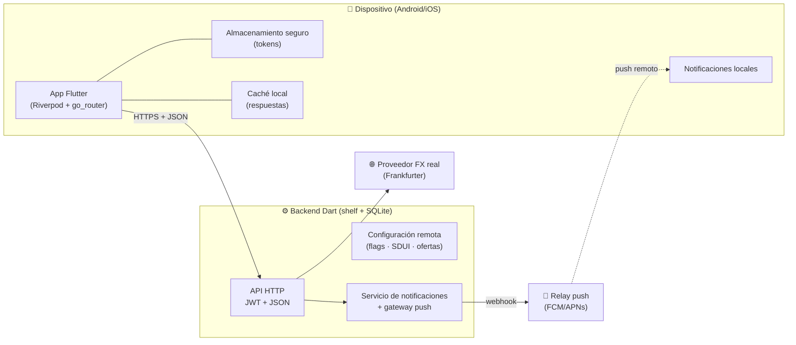
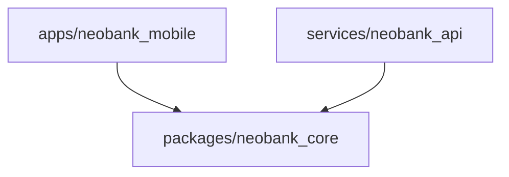
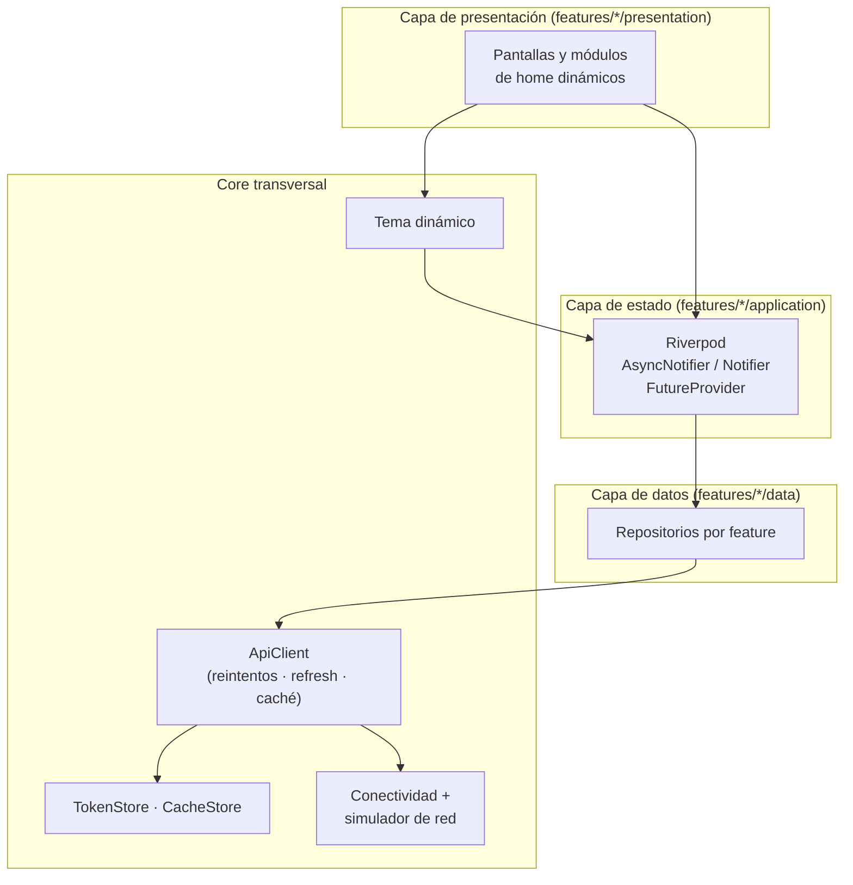
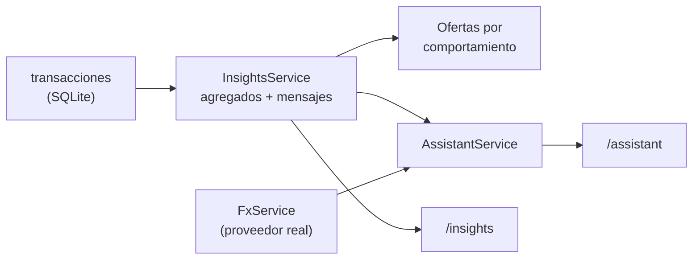
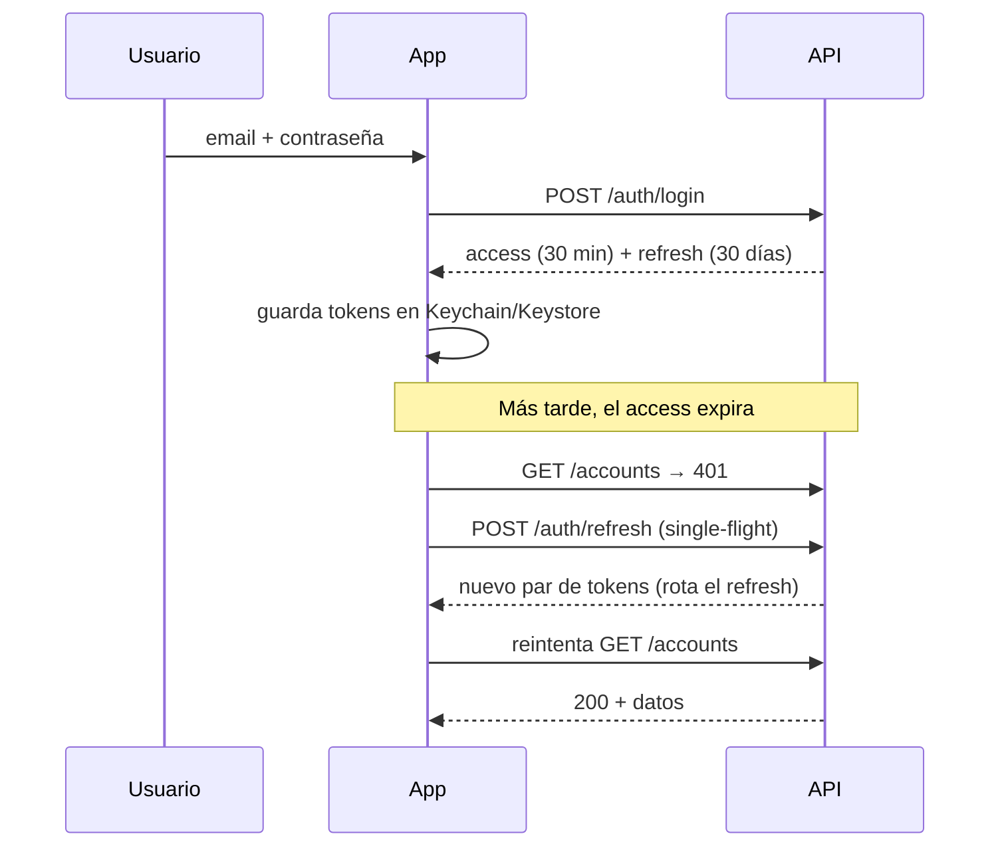
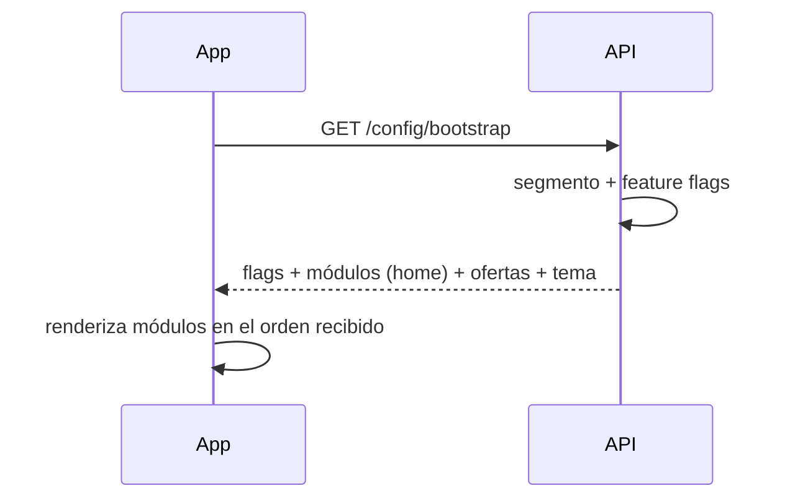
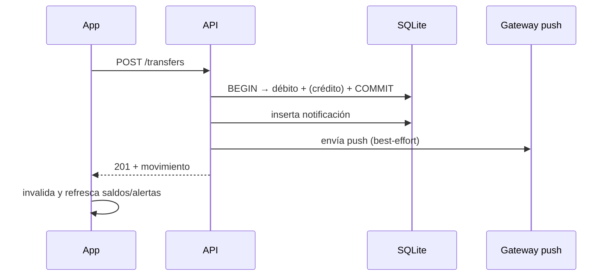
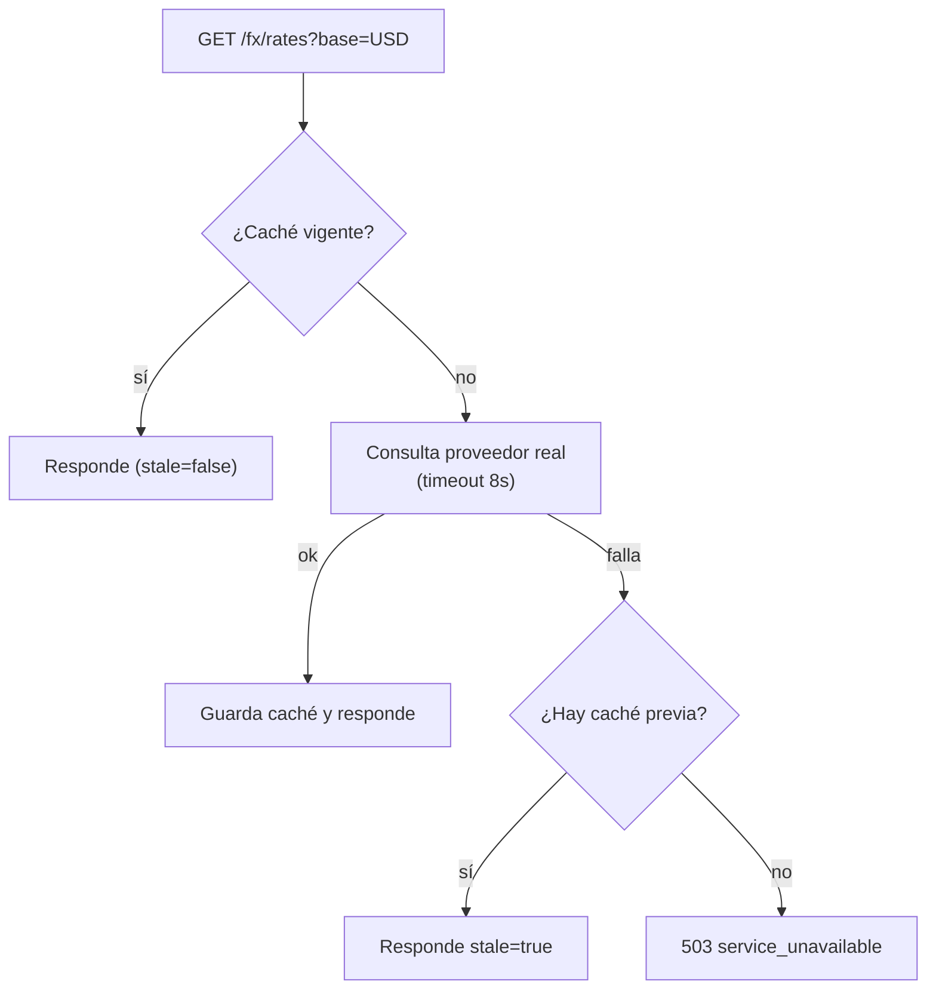
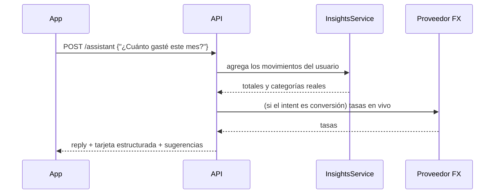

# Arquitectura — Neobank

> Documento vivo. Describe componentes, flujos, supuestos, riesgos y la
> estrategia de escalamiento. Las decisiones puntuales se registran en
> [`decisions.md`](decisions.md).

## 1. Objetivo y restricciones

Construir una plataforma financiera digital **sin atención física**, que pueda
evolucionar hacia **múltiples dominios** administrados por equipos
independientes y que **personalice dinámicamente** la experiencia sin requerir
publicar una nueva versión de la app.

Restricciones del reto:

- La app debe ser **Flutter** (Android/iOS en esta entrega).
- Debe existir **evidencia de interacción real** con servicios y procesamiento
  dinámico (no solo datos simulados).
- Obligatorio demostrar comportamiento ante **conectividad limitada, alta
  latencia e indisponibilidad parcial**.

## 2. Contexto del sistema



## 3. Estructura del repositorio (monorepo)

```text
neobank_app/
├── apps/neobank_mobile/      # App Flutter — arquitectura feature-first
├── services/neobank_api/     # Backend Dart — API, persistencia y servicios
├── packages/neobank_core/    # Contratos compartidos (DTOs, Money, Result)
├── docs/                     # Arquitectura, decisiones, operación, IA, pruebas
└── .github/workflows/        # CI
```

La regla de dependencias es estricta:



`neobank_core` no depende de Flutter ni del backend, lo que permite reutilizar
los contratos y evita acoplar la app a detalles de infraestructura.

## 4. Componentes de la app Flutter



Cada feature es **autónoma**: `auth`, `config`, `home`, `accounts`, `fx`,
`transfers`, `notifications`, `insights`, `assistant`, `profile`, `settings`.
La comunicación entre features ocurre sólo a través de providers públicos, no
de imports cruzados de UI.

### Motor de analítica y copiloto (backend)



## 5. Flujos clave

### 5.1 Autenticación con refresh rotativo



### 5.2 Home dirigido por el servidor (personalización)



El backend decide **qué** se muestra y **en qué orden** (`heroBalance`,
`quickActions`, `fxWidget`, `promo`, `insights`, `offersCarousel`). Incorporar
una nueva experiencia = cambiar la configuración, no publicar la app.

### 5.3 Transferencia con notificación



### 5.4 FX con degradación controlada



### 5.5 Copiloto financiero



## 6. Personalización y segmentación

| Mecanismo | Implementación | Sin publicar app |
| --- | --- | --- |
| Segmentos | `youth · standard · premium · pyme` en el usuario | ✅ |
| Feature flags | Tabla `feature_flags` filtrada por segmento | ✅ |
| Server-Driven UI | Lista ordenada de módulos de home | ✅ |
| Ofertas | Catálogo por segmento **+ generadas por comportamiento** | ✅ |
| Tema | Tokens de color/modo por segmento | ✅ |
| Experimentos | `experimentBucket` A/B en el bootstrap | ✅ |

## 7. Resiliencia ante red degradada

| Escenario | Comportamiento |
| --- | --- |
| Sin conexión (real o simulada) | Banner, lecturas desde caché con aviso, escrituras fallan con mensaje claro y son reintentables |
| Alta latencia | Timeouts configurables, skeletons/spinners, sin bloquear la UI |
| Fallos intermitentes | Reintentos con backoff exponencial (2 reintentos) para errores 5xx/red |
| Sesión expirada | Refresh automático *single-flight*; si falla, se limpia la sesión y se vuelve al login |
| Proveedor FX caído | Respuesta `stale=true` desde caché; la UI lo etiqueta |
| Backend caído | Datos cacheados visibles + acciones deshabilitadas con feedback |

El **simulador de red** (perfil → Simulador de red) permite demostrar todos los
escenarios en vivo: offline, latencia hasta 5 s y tasa de fallos.

## 8. Seguridad

- **Contraseñas**: PBKDF2-HMAC-SHA256, 120 000 iteraciones, salt aleatorio.
- **Sesión**: JWT HS256 (access, 30 min) + refresh opaco de 48 bytes,
  almacenado **hasheado** (SHA-256) y **rotado** en cada refresh.
- **Almacenamiento en el dispositivo**: tokens en Keychain (iOS) / Keystore
  (Android) vía `flutter_secure_storage`.
- **Superficie**: validación de entrada en el backend, autorización por
  propietario de la cuenta, errores sin filtrar detalles internos.
- **Producción** (fuera del alcance de la demo): TLS obligatorio, *certificate
  pinning*, rotación de `JWT_SECRET` por entorno, WAF y rate limiting.

## 9. Observabilidad (resumen)

Detalle en [`operations.md`](operations.md). En la app: logs de red en debug,
errores tipados (`AppErrorKind`) listos para reportar a un backend de crashes.
En el backend: `GET /health`, logging estructurado por request y errores no
controlados registrados con stack trace.

## 10. Supuestos

1. El usuario tiene conectividad intermitente pero no nula de forma permanente.
2. La app se distribuye por tiendas; el backend puede desplegarse en cualquier
   contenedor (Docker) o VM.
3. El proveedor FX es informativo (no ejecuta operaciones cambiarias).
4. Los datos de demo son sintéticos y no representan clientes reales.
5. La demo corre en un entorno controlado; TLS y secretos se gestionan en el
   ambiente real.

## 11. Riesgos técnicos y mitigaciones

| Riesgo | Impacto | Mitigación |
| --- | --- | --- |
| Proveedor FX con límites/caídas | Medio | Caché + stale + timeout + reintentos |
| Crecimiento del backend único | Medio | Rutas por dominio y repositorios desacoplados; listo para dividir en servicios |
| Deriva entre contratos app/backend | Alto | DTOs compartidos en `neobank_core` + pruebas de integración |
| Token expuesto en dispositivo comprometido | Alto | Almacenamiento seguro + refresh rotativo + revocación |
| Configuración remota inválida | Medio | El frontend valida/parsea defensivamente y usa valores por defecto |
| Base de datos SQLite como cuello de botella | Medio | Migrar a PostgreSQL/Cloud SQL manteniendo la interfaz de `Store` |

## 12. Estrategia de escalamiento

1. **Escala horizontal del backend**: el estado vive en la base de datos; el
   servicio es sin estado (JWT) → N réplicas detrás de un balanceador.
2. **Base de datos**: migrar SQLite → PostgreSQL cuando haya concurrencia de
   escritura; `Store` ya encapsula el SQL.
3. **Dominios como servicios**: `accounts`, `transfers`, `config`, `fx` ya
   están separados por handlers/repositorios; extraer cada uno a un servicio
   con su propia base es mecánico.
4. **Config remota como producto**: mover `feature_flags`/SDUI a un servicio de
   configuración versionada con auditoría.
5. **Equipos independientes**: cada feature de la app se puede extraer a un
   paquete Dart (`packages/feature_x`) con su propio pipeline, manteniendo el
   `neobank_core` como contrato.
6. **CDN/edge** para contenido estático de ofertas e imágenes.

## 13. Pruebas

Estrategia y comandos en [`testing.md`](testing.md): pirámide con unitarias
(core/backend/app), widgets y un flujo **E2E** crítico que además cubre el
copiloto.

## 14. Automatizaciones

| Automatización | Comando | Qué hace |
| --- | --- | --- |
| Atajos de desarrollo | `make help` | Instala, analiza, prueba, levanta y formatea |
| Smoke E2E del backend | `make smoke` | Levanta el server real en un puerto efímero y recorre login, cuentas, transferencia, insights, copiloto, home y FX en vivo |
| CI | `.github/workflows/ci.yml` | `analyze` + `test` de los 3 paquetes + job de smoke |
| E2E de la app | `make e2e` | Flujo login → home → copiloto → cuentas → movimientos |

El smoke test es la evidencia reproducible del funcionamiento del sistema con
**dependencias externas reales**.